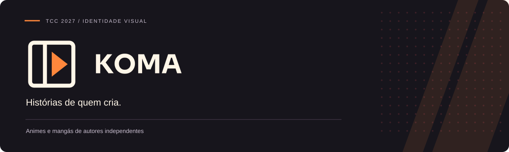

<div align="center">



**Animes e mangás publicados pelos autores.**

HTML independente · 38 telas · 17 blocos tecnológicos · Fontes incorporadas

[Abrir o HTML](index.html) · [Telas](docs/telas.md) · [Stack](docs/tecnologias.md) · [Arquitetura](docs/arquitetura.md)

</div>

## O projeto

Aplicativo gratuito para descobrir, assistir e ler obras publicadas por estúdios e autores independentes.

> Briefing e prévias locais para uma plataforma gratuita. Login, catálogo compartilhado, HLS e publicação editorial são implementação planejada.

Este repositório contém o **briefing técnico navegável e suas demonstrações locais**. As integrações de produção descritas no projeto são o escopo de desenvolvimento, sem servidor compartilhado ou credenciais nesta versão.

## Experimente agora

1. Baixe o repositório em **Code → Download ZIP** ou clone com o comando abaixo.
2. Abra `index.html` no navegador.
3. Explore as telas, filtre a stack e teste a simulação identificada.
4. Use **Imprimir / salvar PDF** para obter a especificação completa, ou exporte o briefing em JSON.

```bash
git clone https://github.com/perabru/koma-animes-mangas.git
cd koma-animes-mangas
```

O arquivo inclui HTML, CSS, JavaScript, fontes e recursos visuais. Não exige instalação, `npm install`, chave de API ou internet para navegar. Os links da documentação oficial exigem conexão.

## O que está disponível

| Recurso | Esta versão |
| --- | --- |
| Inventário de telas | Busca, filtros, objetivo, campos, ações, estados, API e aceite |
| Tecnologias | Responsabilidade, local de uso, contrato e documentação |
| Método | Equações e demonstração com dados locais ou sintéticos |
| Entrega | Responsáveis, testes, pendências e sequência de implementação |
| Impressão | Anexo completo de telas, mesmo com filtro ativo |
| Serviço de produção | Especificado; depende de implementação e homologação |

## Tipografia e identidade

| Papel | Família | Intenção |
| --- | --- | --- |
| Títulos e marca | **Sora** | Títulos de catálogo firmes com texto arredondado e acolhedor. |
| Texto e controles | **Nunito Sans** | Leitura mais confortável em parágrafos, listas e botões. |
| Código e medidas | **JetBrains Mono** | Alinhamento de valores, rotas e equações. |

As fontes são incorporadas no HTML em WOFF. Textos, controles e rótulos receberam tamanhos maiores e mais espaço entre linhas. Os avisos SIL OFL acompanham o projeto em [créditos de terceiros](THIRD_PARTY_NOTICES.md).

## Percurso principal

1. **Enviar:** Autor registra obra e créditos.
2. **Preparar:** Workers validam e processam.
3. **Revisar:** Moderação analisa a versão.
4. **Publicar:** Arquivos aprovados seguem à CDN.
5. **Consumir:** Player, leitor e progresso.

## Telas por área

| Área | Telas |
| --- | ---: |
| publico | 18 |
| estudio | 15 |
| admin | 5 |
| **Total** | **38** |

[Consultar todas as telas e critérios de aceite →](docs/telas.md)

## Quem participa

| Área | Responsabilidade |
| --- | --- |
| Público | Descoberta, player, leitor e lista pessoal. |
| Estúdio | Obras, créditos, envios e publicação. |
| Moderação e operação | Revisão, denúncias, filas e disponibilidade. |

## Critérios do piloto

- [ ] Obra reprovada não aparece no catálogo.
- [ ] Conta de estúdio A não altera a obra de B.
- [ ] Falha e repetição não duplicam arquivos ou publicação.
- [ ] Player e leitor conservam progresso válido.

Os itens descrevem testes da aplicação final. Marcar o checklist do briefing registra leitura local e não comprova a implementação.

## Decisões abertas

- Confirmar infraestrutura e orçamento do piloto.
- Homologar mídia, acessibilidade e retirada da CDN.

## Organização do repositório

| Caminho | Conteúdo |
| --- | --- |
| [`index.html`](index.html) | Briefing completo e independente |
| [`docs/telas.md`](docs/telas.md) | Inventário das telas |
| [`docs/tecnologias.md`](docs/tecnologias.md) | Stack proposta e fontes |
| [`docs/arquitetura.md`](docs/arquitetura.md) | Fluxo e dados do domínio |
| [`docs/banner.svg`](docs/banner.svg) | Identidade aplicada ao README |
| [`font-licenses/`](font-licenses/) | Licenças das fontes incorporadas |
| [`THIRD_PARTY_NOTICES.md`](THIRD_PARTY_NOTICES.md) | Créditos e limites de licenciamento |

## Validação desta entrega

- Sintaxe dos scripts e integridade dos recursos incorporados.
- Referências entre telas e tecnologias.
- Navegação e tipografia verificadas na prévia do navegador.
- Preservação das demonstrações e dos critérios do briefing anterior.

---

<div align="center">

**KOMA** · Projeto de [Bruno Michel Pera](https://github.com/perabru)

Briefing técnico · Documentação em português · 2026

</div>
