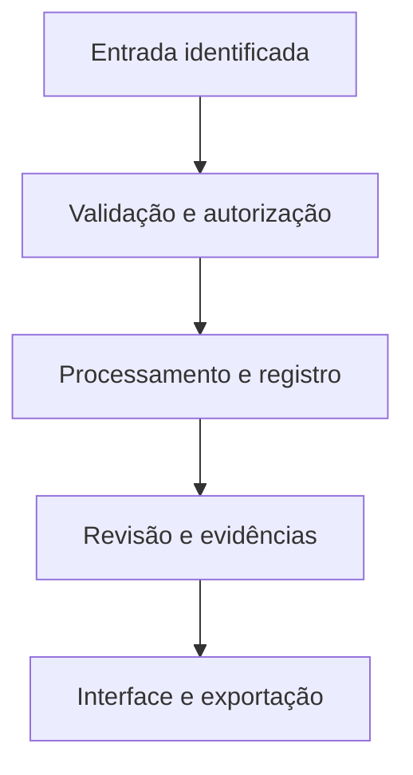

# Arquitetura proposta

## Enviar

Autor registra obra e créditos.

## Preparar

Workers validam e processam.

## Revisar

Moderação analisa a versão.

## Publicar

Arquivos aprovados seguem à CDN.

## Consumir

Player, leitor e progresso.

## Dados do domínio

- **Conta e perfil** — User, Profile · ID do provedor, nome público, avatar, situação e preferências. Senhas pertencem ao provedor de identidade.
- **Estúdio e membros** — Studio, StudioMember · Slug, apresentação, usuário, papel e situação do vínculo; unicidade por usuário e estúdio.
- **Obra e créditos** — Work, Credit, RightsDeclaration · Tipo, título, sinopse, classificação, titularidade, licença, territórios e versão da declaração.
- **Estrutura do anime** — Season, Episode, Subtitle · Numeração, vínculo com a obra, asset, idiomas, duração processada e estado de publicação.
- **Estrutura do mangá** — Chapter, Page · Numeração do capítulo, ordem das páginas, dimensões, asset e transcrição fornecida.
- **Arquivos** — MediaAsset, Rendition · Chave S3, MIME, tamanho, checksum, original, derivados e estado de processamento.
- **Experiência pessoal** — Favorite, Progress · Usuário + obra como chave única para favoritos; item, segundos/página, versão e última atualização para progresso.
- **Publicação e revisão** — Release, ModerationReview · Versão analisada, parecer, revisor, agenda, liberação e retirada.
- **Casos e auditoria** — Report, AuditEvent · Alvo, motivo, situação, ator e alteração registrada, com retenção e acesso definidos.

## Contas e permissões

Sessão no servidor, autorização por papel e propriedade, arquivos privados por escopo e auditoria de mudanças. A interface nunca é a única barreira de acesso.
